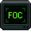
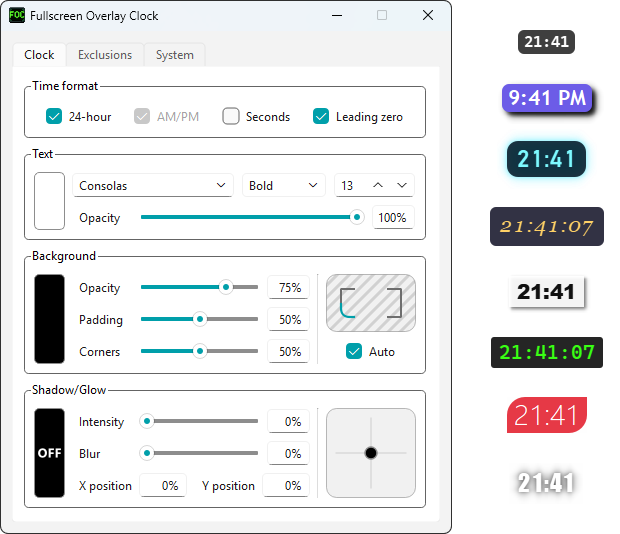

#  Fullscreen Overlay Clock
A lightweight, customizable clock that floats over fullscreen games and apps.

<a href="https://apps.microsoft.com/detail/9PJCDSKT048V?mode=direct"><picture><source media="(prefers-color-scheme: dark)" srcset="https://get.microsoft.com/images/en-us%20light.svg"></picture></a>  

<a href="https://ko-fi.com/theconfax"><picture><source media="(prefers-color-scheme: dark)" srcset="assets/ko-fi-light.png"></picture></a>  

## Why this?
When a game or a video goes fullscreen, the taskbar goes away, and its clock with it. So you either Alt-Tab out to check the time, or lose track of it.

This project puts the time back on screen, **without getting in your way**.

## What does it do?
It shows the system time in a small overlay **only while a fullscreen app is in front**: a game, a video, a presentation. On the desktop it stays out of sight, unless you want it always on.

<picture><source media="(prefers-color-scheme: dark)" srcset="assets/foc-overview-dark.png"></picture>

### Featuring:
- **A fully customizable look:** time format, font, weight and size, colors and opacity, rounded corners, shadow or glow
- **Easy placement:** it snaps to the screen borders when dragged, supports multiple monitors, and the scroll wheel fine-tunes its position
- **Per-app exclusions:** keep it off the apps you choose
- **Zero interference:** it never steals focus, and while you play, clicks go straight through it
- **Set and forget:** a lightweight tray app that starts with Windows and shows the clock only when needed

## Installation
**Install from the Microsoft Store**

<a href="https://apps.microsoft.com/detail/9PJCDSKT048V?mode=direct"><picture><source media="(prefers-color-scheme: dark)" srcset="https://get.microsoft.com/images/en-us%20light.svg"></picture></a>  

<a href="https://ko-fi.com/theconfax"><picture><source media="(prefers-color-scheme: dark)" srcset="assets/ko-fi-light.png"></picture></a>  

## Usage
> [!NOTE]
> A short tutorial covers all of this on first launch.

### The clock
- 🔓 **Right-click the clock** to unlock it: arrows appear around it and you can drag it anywhere. It snaps to the screen borders.
- 🖱️ Hover the arrows (or the clock) and use the **scroll wheel** to fine-tune its position.
- 🔒 Right-click again, press Esc or **click elsewhere** to lock it.

While you play, the clock lets every click through to the game, so you can't hit it by mistake. As soon as the cursor is back (menus, map, videos) you can right-click it again.

### Settings
Open the settings from the ⚙️ cog on the unlocked clock, by double-clicking the tray icon, or via the right-click tray menu. Changes apply live and stay saved.
- **Clock**: time format, text, background, shadow/glow
- **Exclusions**: the apps the clock won't appear above. *Exclude current app* picks the one you're looking at.
- **System**: monitor, always show the clock, start with Windows, theme, language, reset and about

#### Start with Windows
The clock turns on *Start with Windows* once, at the end of the tutorial, so it's there next time you play. You can turn it off any time in **System → Autostart**.

## Limitations

### Exclusive fullscreen games
The clock cannot appear over a game running in **exclusive fullscreen**: no window can, short of hooking into the game's graphics, which is exactly what anti-cheat systems look for.

> [!TIP]
> If you don't see the clock in a game, switch the game to **borderless** (or **windowed fullscreen**).

### Universal Windows Platform (UWP) apps
The clock cannot appear over a **UWP app** (like Calculator) put in fullscreen. Windows lifts these apps into a layer above every regular window, and grants access to that layer only to accessibility tools.